<p align="center">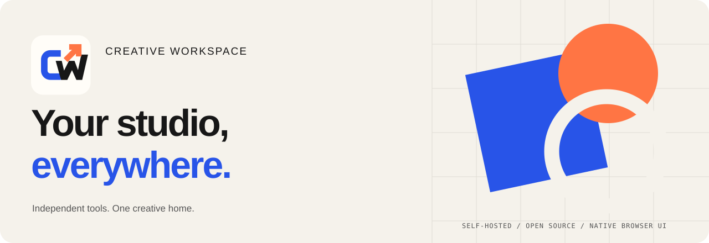</p>

# Creative Workspace

**Version: 0.2.0-alpha.59** — prototype/prerelease candidate. The original DesignCraft Layout → Pages → Delete Page action now routes through one bounded server-worker ACK/read-model/render slice. Server processing remains the self-hosted product goal; this does not complete DesignCraft. The alpha.59 change corrects the exact-pinned ACK test fixture; its focused Rust test passes. Actions-built OS bundles and the immutable draft release are pending. The protected [local studio](docs/test-suite-alpha51-20261017.md) stays separate.

Bring your creative tools together in one browser studio. Choose an application, select your files, and access your own server from a lightweight laptop. The goal is **the original application interfaces and tools in the browser, with the server doing the heavy work**: photography, image editing, illustration, PDF, publishing, video, motion graphics, office documents, spreadsheets, presentations, CAD, interface design and audio. Browser controls run locally; document commands, data and previews travel to the server. No VNC or remote desktop is involved.

[Browser-processing demo](https://creative-workspace-demo.pages.dev/) · [Download releases](https://github.com/vedranius/creative-workspace/releases) · [Install](#installation) · [Screenshots](#screenshots) · [Changelog](CHANGELOG.md) · [Roadmap](docs/original-app-port-plan.md) · [License](LICENSE.md) · [Original projects](#original-projects-and-authors)

> **Current scope:** RapidRAW has an independently owned browser/server integration. All thirteen ArtCraft original interfaces have been built and browser-verified as previews. DesignCraft's guarded pinned UI has bounded server-owned action and file-flow candidates. Alpha.45 adds the original CADCraft drafting preview; Chromium confirms its sample, command line, DXF download and chooser reopen. Alpha.46 adds the original FigCraft v0.6.0 interface and Frame tool. Alpha.47 adds the SoundCraft v0.7.0 audio workstation preview; its WASM UI uses browser-local audio/session processing and WebAudio, with server/provider integration pending. Alpha.44 adds the original DeckCraft preview; alpha.49 adds Edit > Deselect All/Escape, alpha.50 adds Edit > Clear, and alpha.51 verifies Clear → Ctrl+Z with the original Undo ACK/read-model/server render. Select All, Selection Tool `selection.set`, graphic-frame creation, and text actions are also bridged. Real browser permission, laptop write ACK/recovery, remaining tools/actions and full parity remain pending. **No complete server-backed original ArtCraft port is accepted yet.**

Alpha.24 adds an original Open-dialog candidate for a selected laptop `.designcraft` file: streaming copy-first upload is acknowledged in the same isolated session before the native server opens it and returns original UI state/server preview. Alpha.26 adds the original File → Save a Copy… candidate for an explicit new server-workspace path with workspace retention; native and atomic write ACKs precede success, the source stays dirty under its original name, and an existing path is never overwritten. Laptop output is refused until browser write ACK exists. This remains an isolated review candidate; catalog and full parity stay planned. [Open and Save Copy scope](docs/designcraft-host-canvas.md).

## What is new

- **Native RapidRAW WASM experiment:** a separate pinned-source port preserving the original image algorithms and intended React interface. Actual public CC0 RAW Speed development, native f16 upload and exposure/shader frames match native. The original EightBit PNG path now retains dithering and produces three byte-identical native PNG files, with browser decode/completed downloads. Original camera exposure metadata now matches native on the public DNG and two explicit signed-rational variants, including36 exact UI/baseline mappings. Original as-shot WB and adjustment/adaptation mapping now also match native on that DNG (58 exact scalars). Actual WB/exposure now drives five original shader/PNG frames matching native exactly (3,932,160 byte components, completed downloads). Remaining global defaults/preprocessing/controls, original UI and common-provider/full editor acceptance remain unfinished; this port is not yet in the public demo. [Milestones and acceptance](docs/rapidraw-wasm-port.md).

- **Browser playground (alpha.57):** twelve original interfaces with explicit consent that processing uses the visitor's computer. The independent Cloudflare Pages export preserves licenses and source provenance while excluding private workspaces/backends. The main product continues toward server processing. [Demo and deployment](docs/cloudflare-demo.md).

- **DesignCraft PAR-03 Delete Page (alpha.59 candidate):** the pinned original `app.deletePage` action sends unchanged `layout.pages.delete` to the owned worker; gateway bounds page indexes and refuses deleting the final page. UI hydration waits for its ACK. Alpha.59 fixes its exact-source Rust test setup; production behavior and browser evidence remain from alpha.58. This is one action only; real folder permission and full parity remain open, so DesignCraft stays planned pending Actions and asset verification. [Handoff](docs/par-03a-handoff.md).

- **DesignCraft PAR-03 Duplicate Spread (alpha.56 candidate):** the exact-pinned original Layout → Pages → Duplicate Spread menu action reaches the owned server worker as `layout.pages.duplicateSpread`; Chromium confirms matching ACK, two-spread server read-model and revisioned render. This proves one action only. Real folder permission and full parity remain open; DesignCraft stays planned pending Actions/release verification. [Browser JSON](docs/evidence/designcraft-par03-duplicate-spread-browser.json).
- **DesignCraft PAR-03 Actions gate (alpha.55):** original File → Save a Copy passed server and laptop-on-demand write/reopen checks in a browser fixture; injected close failure retained recovery bytes, preserved the dirty source/name, returned no false success ACK, and refused same-target retry. Real OS folder permission and full parity remain unverified. [Release verification](docs/evidence/creative-workspace-alpha55-release.md).


- **DesignCraft recovery access and native `text.delete` fix (alpha.54):** the clean Actions Chromium job verified the original worker action sequence and downloaded a retained native-worker-generated copy through the shared recovery view. Journal failure state and provider chooser remain fixtures. Real folder permission, original Save a Copy failure/recovery and full parity remain unverified. [Evidence](docs/evidence/designcraft-par03-recovery-entry.md) · [release verification](docs/evidence/creative-workspace-alpha54-release.md) · [handoff](docs/par-03a-handoff.md).

- **DesignCraft Text Tool Backspace/Delete (alpha.52):** the original Backspace action reaches the owned worker as `text.delete`; Chromium verifies `INK` → `IN`, revision 9 and a changed server-render PNG. The upstream source mirror accepted the action; alpha.53 clean Actions later exposed a separate omission in the owned native adapter, corrected in alpha.54. Provider permission/write ACK/recovery and full parity remain pending. [Browser evidence](docs/evidence/designcraft-par03-text-delete-browser.json).

- **DesignCraft Undo ACK identity (alpha.51):** gateway responses now echo the exact `edit.undo`/`edit.redo` command ID and reject extra parameters. Original Clear → Ctrl+Z restores server-owned `INK` and the exact pre-Clear server PNG at revision 10. The provider chooser is synthetic; DesignCraft remains planned. [Browser evidence](docs/evidence/designcraft-par03-edit-clear-undo-browser.json).

- **DesignCraft Edit > Select All server action (alpha.48):** original Ctrl+A reaches the owned worker as `edit.selectAll`; Chromium confirms the matching ACK selects every server document item at revision 3 and presents the refreshed server render in the original UI. Provider permission/write ACK/recovery and full app parity remain pending. [Scope and evidence](docs/par-03a-handoff.md).

- **SoundCraft original audio-workstation preview (alpha.47):** exact-pinned v0.7.0 original interface loads in Chromium from the registered browser package. Audio editing, decode/DSP, playback and export remain browser WASM; server processing, provider/write ACK/recovery and full parity are pending. [Build, screenshots and evidence](docs/soundcraft-original-ui-preview.md).

- **FigCraft original interface-design preview (alpha.46):** exact-pinned FigCraft v0.6.0 loads its original design/prototype workspace; Chromium created a frame with the original Frame tool. The web build starts blank and has no browser file open/save integration; design state and rendering run in browser WASM. Server/provider and full parity acceptance remain pending. [Build, screenshots and evidence](docs/figcraft-original-ui-preview.md).

- **CADCraft original drafting preview (alpha.45):** exact-pinned CADCraft v0.7.0 opens the bracket sample and original drafting interface. Chromium verified a circle command, DXF download and chooser reopen. Geometry and conversion run in browser WASM; server/provider acceptance remains pending. [Build, screenshot and evidence](docs/cadcraft-original-ui-preview.md).
- **DeckCraft original presentation preview (alpha.44):** exact-pinned DeckCraft v0.7.0 opens the original ribbon, slide list, Northern Lights sample and canvas. This preview processes the deck in browser WASM. It is not a server adapter; the app remains planned. [Build, screenshot and evidence](docs/deckcraft-original-ui-preview.md).

- **Original interfaces from one studio:** registered PhotoCraft, VectorCraft, PdfCraft, DesignCraft, LightCraft, FilmCraft, EffectCraft, WordCraft, GridCraft, DeckCraft, CADCraft and FigCraft launch on the studio's own origin at `/original/<app>/`. Invalid or missing packages stay unavailable. [Installation and browser evidence](docs/studio-original-uis.md).
- **FilmCraft MKV/WebM import fix:** a reviewed patch to the original media browser handles pending reads, duplicate requests, selection/bin changes, cancellation and metadata retry. Eight isolated browser cases passed; this is not a claim that every codec or video export works. [Fix and evidence](docs/filmcraft-mkv-import-handoff.md).
- **DesignCraft PAR-03 edit/read-model candidate:** original `file.new`, graphic `frame.create`, Selection Tool `selection.set`, Type Tool caret and ordered text actions reach the owned native worker. Chromium confirms selection ID 8 and server read-model hydration at revision 5, then Type Tool actions through revision 14 with server render. Actions passed and the alpha.39 release assets/checksums are verified. Real browser permission, laptop write ACK/recovery and full original tool parity remain pending; the catalog stays planned. [Bridge scope and evidence](docs/designcraft-par03-sample-bridge.md).
- **DesignCraft original preset action seam (alpha.17):** the gateway accepts the original `file.new` action with exactly one bounded `preset` parameter and forwards it unchanged to its owned worker. A protocol fixture verifies the action ID, params and acknowledged read model. The original UI click is not wired yet; this does not add an availability claim.
- **Original DesignCraft server action candidate (alpha.26):** original Open, A4, Rectangle/Undo and File → Save a Copy route to the owned worker. Save Copy requires a new server workspace path and workspace retention, waits for byte/write ACK, keeps the source dirty and refuses laptop output without browser write ACK. It remains unregistered; other actions, provider recovery and full parity are pending. [Scope and isolated verification](docs/designcraft-host-canvas.md).
- **Original DesignCraft Undo/Redo candidate (alpha.29):** the original Ctrl+Shift+Z `edit.redo` now follows the server pending/ACK path and refreshes the canonical document/render only after worker success. Chromium verifies revisions 1–5 across A4, frame creation, Undo, Redo and Undo. It remains unregistered; provider binding, laptop write ACK, save/reopen recovery, other actions and full parity are pending. [Evidence](docs/evidence/designcraft-par03-redo.md).
- **DesignCraft canonical snapshot transport (alpha.18):** the owned worker returns the canonical upstream `Document` in a bounded response; the gateway separately validates the snapshot and forwards it at the acknowledged revision. Native, protocol and Chromium RPC evidence pass. Original `DesignApp` hydration is still pending, so this remains integration groundwork.
- **Release foundations:** GitHub Actions builds Linux x64, Windows x64 and Apple Silicon macOS native-prototype bundles with an embedded Node 24 runtime, licenses, manifests, native smokes and checksums. FilmCraft and DesignCraft preview archives have separate build jobs. Alpha.18 Actions built and verified all target bundles, previews, ten release assets and checksums; keep it draft because original DesignApp state, provider and full parity are pending. [Alpha.18 release evidence](docs/evidence/creative-workspace-alpha18-release.md).
- **A visual project guide:** real screenshots of the studio and all eight applications, an original CW logo, installation instructions and explicit source/license attribution.

Alpha.51 is a verified draft release. It fixes original Undo/Redo ACK identity and passes the local DesignCraft protocol suite, Chromium Clear → Undo server-render proof, Actions build and three-platform Checks. All 12 downloaded archive/checksum pairs verify. Full DesignCraft provider permission, laptop write ACK/recovery, save/reopen and original UI parity remain unaccepted, so the release stays draft and the catalog planned. See [PAR-03 handoff](docs/par-03a-handoff.md) and [release evidence](docs/evidence/creative-workspace-alpha51-release.md). Do not treat any draft as an available DesignCraft application. Every new product feature/fix receives its own version and changelog; documentation-only updates retain the product version. [Release requirements and upgrade guide](docs/releases.md).

## Applications and current status

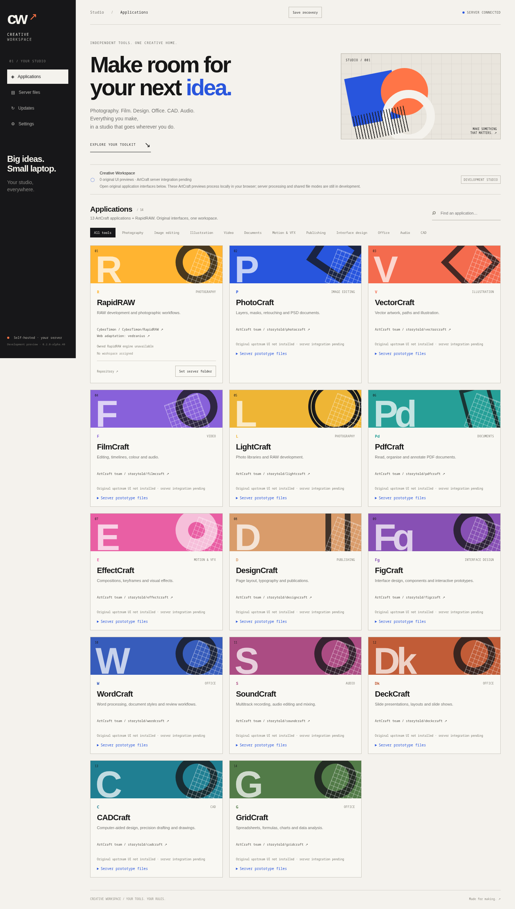

Catalog screenshot from an isolated instance without engine installations; it does not show editor availability.

| Application | Creative purpose | Current integration |
| --- | --- | --- |
| **RapidRAW** | RAW development and photography | Owned browser/server adapter; identity-checked independent installation. Separate CLI install; not in portable bundles. |
| **PhotoCraft** | Images, layers, masks and retouching | Original UI preview verified. Original server/provider integration pending; limited native prototype also exists. |
| **VectorCraft** | Vectors, shapes, paths and illustration | Original UI preview verified. Original server/provider integration pending; limited native prototype also exists. |
| **PdfCraft** | PDF viewing, page organisation and annotation | Original UI preview verified. Original server/provider integration pending; limited native prototype also exists. |
| **DesignCraft** | Page layout, typography and publications | Original UI preview and bounded server-owned action candidate for Open, A4, graphic frame, Selection Tool, Edit > Select All, Type Tool and server-retained Save Copy. Actions verification, real picker permission, provider recovery and full parity remain pending; catalog stays planned. |
| **LightCraft** | Photo library and RAW development | Original UI preview and separate native CPU/recipe groundwork. Original server/provider acceptance pending; not bundled. |
| **FilmCraft** | Video timeline, colour and audio | Original UI preview with reviewed MKV/WebM import fix. Server media/proxy/render/provider integration pending. |
| **EffectCraft** | Motion graphics, composition and VFX | Original UI/demo preview verified. Server/GPU/render/provider integration pending; headless GPU-worker limits documented. |
| **WordCraft** | Word processing and document design | Original v0.7.0 ribbon/WASM preview verified from its pinned upstream source. Editing, layout, render and browser download run in browser WASM; server processing/provider/write ACK/recovery and full parity remain pending. Catalog stays planned. |
| **SoundCraft** | Audio recording, editing and mixing | Original v0.7.0 UI preview verified at its pinned source; decode/DSP/playback/export remain browser-local, with server/provider acceptance pending. Catalog stays planned. |
| **FigCraft** | Interface design and prototypes | Original v0.6.0 UI preview verified from its pinned upstream source. Browser WASM owns design state; open/save, server processing/provider/write ACK/recovery and full parity remain pending. Catalog stays planned. |
| **GridCraft** | Spreadsheets and data analysis | Original v0.7.0 workbook UI verified at the pinned source. Calculation/edit/export currently run in browser WASM; server/provider/write ACK/recovery, real picker permission and full parity remain pending. Catalog stays planned. |
| **DeckCraft** | Presentations and slide shows | Original v0.7.0 presentation UI preview verified from its pinned upstream source. Editing, media decode, render and conversion run in browser WASM; server/provider/write ACK/recovery and full parity remain pending. Catalog stays planned. |
| **CADCraft** | Computer-aided design and drafting | Original v0.7.0 UI preview verified from its pinned upstream source; geometry/export run in browser WASM. Server/provider acceptance is pending; catalog stays planned. |

Purpose describes each upstream project, **not a promise that every upstream function is already supported here**. Screenshots show real original interfaces; launch/render evidence does not establish complete browser/native parity or file-save acceptance. [Acceptance plan for every app](docs/original-app-port-plan.md).

The [full ArtCraft expansion plan](docs/artcraft-expansion.md) records the six added upstream projects, their verified release/browser-build candidates, original UI/server acceptance gates and implementation order. Every catalog entry participates in per-app server-folder configuration, copy-first file transfers and GitHub release checks. A catalog entry does not install an engine or establish its compatibility.

## How the workspace works

The **control panel** lists applications and their upstream authors, searches/filters the catalog, assigns a separate server folder per app, imports laptop files, browses/downloads server files, checks GitHub releases and exposes save recovery. Each creative application has its own managed engine and isolated document sessions where implemented. The existing user RapidRAW Web service is never reused or modified.

Original UI packages contain the original shared upstream Rust/egui interface and WASM, a pinned source identity, source licenses and asset hashes. The loader checks integrity and serves them on the same authenticated origin. FilmCraft and DesignCraft use explicitly recorded reviewed patch variants. Original UI and native engine revisions must be staged and verified together on future upgrades; updating one component alone does not establish compatibility.

The shared provider supplies selected-file metadata, ranges, caches and destination writes to accepted adapters. An engine that needs filesystem paths can use a session-scoped mount. This is file transport, not desktop transport. A document preview sent by an engine is permitted; the application controls remain native browser UI.

### Files on your laptop or server

| Working mode | What happens | Current scope |
| --- | --- | --- |
| **Server workspace** | Import selected files/folders first, then process the server copies. Originals remain on your laptop. | Portal import/download and implemented native adapters. |
| **Laptop on demand** | Keep originals locally; a connected browser agent supplies requested file ranges to the server. Opening one file can still require all its bytes. | Common provider and generated Linux native proofs; original ArtCraft UIs not connected yet. |
| **Hybrid** | On-demand reads take priority while remaining originals copy to the server in the background. | Limited prototype/provider flow; stress/reconnect acceptance pending. |
| **Copy first** | Transfer the selected folder before editing server copies. | Upload fallback works without a mount; prototype folder-sharing flow also exists. |

**Source mode, save destination and retention are separate choices.** A fetched original can be temporarily cached or retained. Save results to the server and download them, or to an explicitly permitted laptop folder where that adapter supports it. Laptop save success requires the browser's write acknowledgement. Uncertain outputs remain in a durable recovery journal; recovery downloads use separate `.recovered` copies. Automatic conflict-safe replay is still pending.

On-demand/hybrid require a compatible secure browser page, granted folder access and a suitable server helper. Chrome/Edge File System Access on HTTPS or localhost is the reference path. Linux FUSE has generated native evidence; Windows/WinFsp runtime acceptance is pending; macOS on-demand server mounts are unsupported. Ordinary file/folder upload remains the fallback. A disconnected laptop cannot supply uncached data. [Provider requirements and exact limits](docs/storage-modes.md).

**Import from laptop** accepts files, a folder, or file drag-and-drop; folder selection preserves the relative tree. Empty directories are not transferred. Uploads stream to temporary files and publish under new names without overwriting originals. Progress/cancel are available; completed files stay imported after a later cancellation. Default limit is 2 GiB per file (`MAX_UPLOAD_BYTES`); transfers are not resumable yet.

`Directory is outside WORKSPACE_ROOTS` refers to a **server** path. Use an allowed absolute server folder, the default workspace, or **Import from laptop** to choose files on the visiting computer. A laptop path cannot become a server path merely by entering its name.

### Updates and reliability

- GitHub stable release checks run manually and every 24 hours while the service is running. The panel distinguishes unchecked, released, no published release and check failure.
- An upstream release is labeled **adapter compatibility not verified**. Automatic installation, activation, rollback and tag-only tracking are pending.
- Root confinement, per-session isolation, Origin/auth checks and bounded payloads apply to the gateway. Non-loopback access requires authentication.
- Engine installers are currently administrator CLI tools. The control-panel install queue and importing arbitrary GitHub repositories are future adapter-based features.
- MCP/AI-assisted editing is planned; no MCP endpoint or subscription-based AI editor is implemented yet. [AI/MCP plan](docs/ai-assistant.md).

### Legacy native prototypes

These are genuine owned upstream engines behind **limited custom HTML interfaces**, retained for existing work. They do not fulfill the original-UI requirement. PhotoCraft covers brush/layers/adjustments/history and layered saves; PdfCraft covers server page rendering, rotate/move/delete, notes and PDF export; VectorCraft covers shapes/paths, position/colour, editable native and SVG/PDF/PNG output; DesignCraft covers text frames, typography, overset/reflow and native/PDF/PNG output. LightCraft has a separate CPU/recipe foundation but stays planned.

Native Linux and generated on-demand proofs exist for the four main prototypes, including selected-file reads, separate outputs and save acknowledgement. DesignCraft also has a bounded original-UI/server action bridge for its Type Tool text insertion and Backspace/Delete, with worker ACK and server-render refresh. This is one verified slice, not full DesignCraft availability: real folder permission, laptop write ACK/recovery, open/edit/save/reopen and broad original parity remain open. These proofs are distinct from real user folder permissions, broad format compatibility and acceptance of an original UI. [PAR-03 action evidence](docs/evidence/designcraft-par03-text-delete-browser.json) · [Detailed validation](docs/validation.md).

## Screenshots

Actual browser captures with demo/generated content. The ArtCraft screenshots below are **original upstream interfaces**, not the legacy HTML editors. [Capture provenance, pins and limitations](docs/screenshots.md).

### Creative Workspace studio

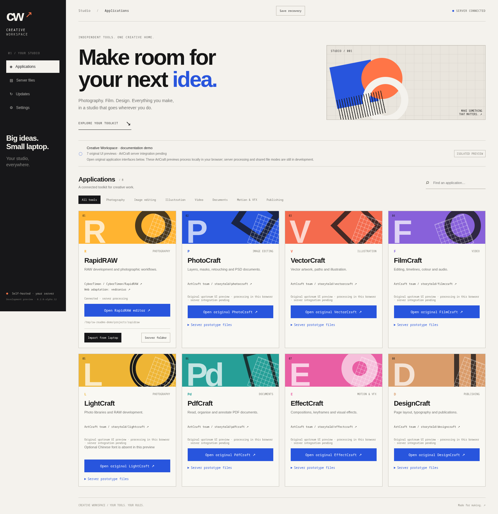

Historical screenshot of the earlier eight-project catalog, with original-author links and explicit implementation status. This isolated documentation instance uses demo folders; its native prototype engines are intentionally not started.

### Laptop import and server files

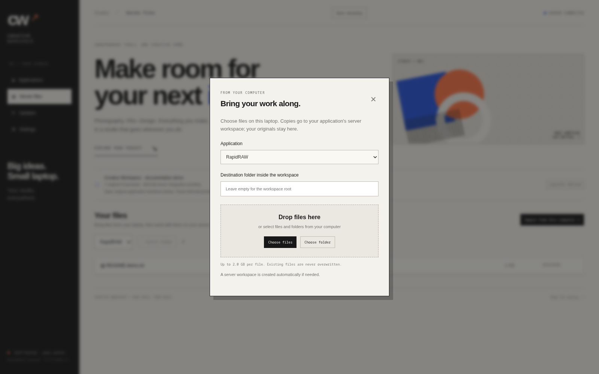

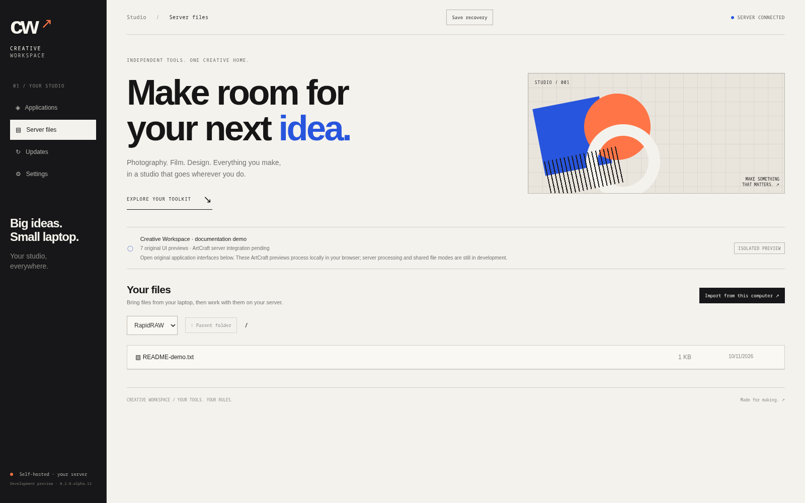

### GitHub updates, settings and recovery

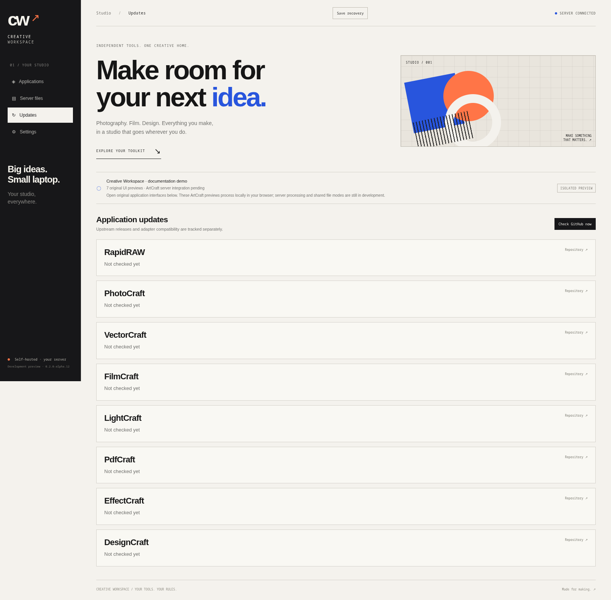

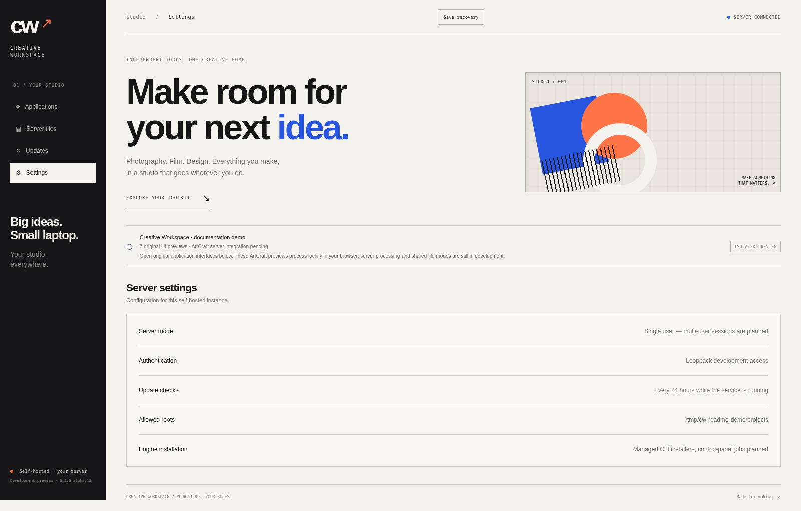

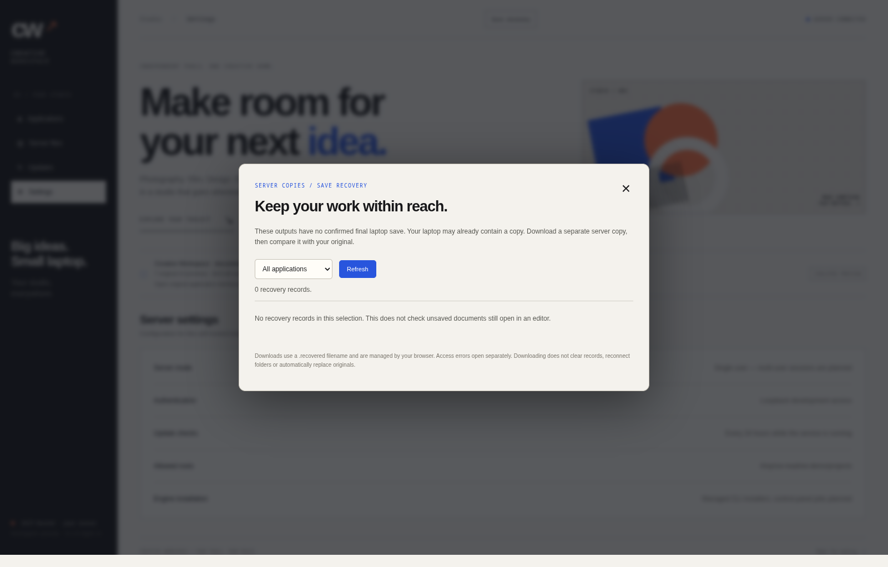

### RapidRAW — CyberTimon / web adaptation by vedranius

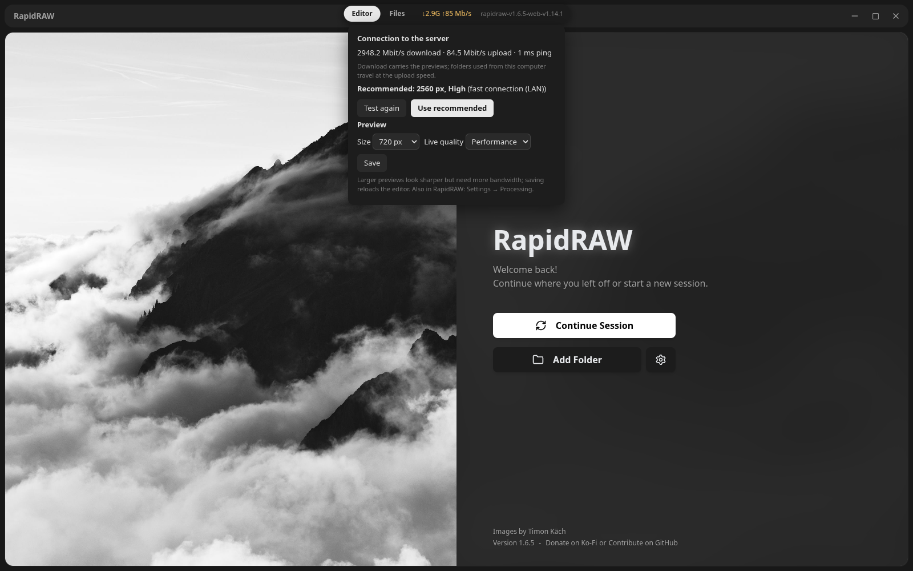

[Original RapidRAW](https://github.com/CyberTimon/RapidRAW) · [RapidRAW Web fork](https://github.com/vedranius/rapidraw-web) · [Independent engine installation](engines/rapidraw/README.md)

### PhotoCraft — ArtCraft / storytold

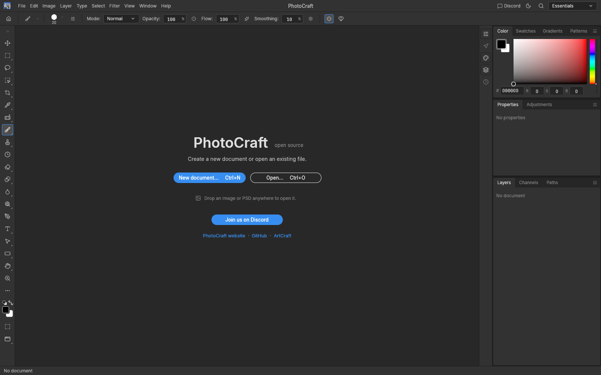

[Original project](https://github.com/storytold/photocraft) · [Original UI build and evidence](docs/photocraft-original-ui-preview.md). Browser-local preview; original server/provider integration pending.

### VectorCraft — ArtCraft / storytold

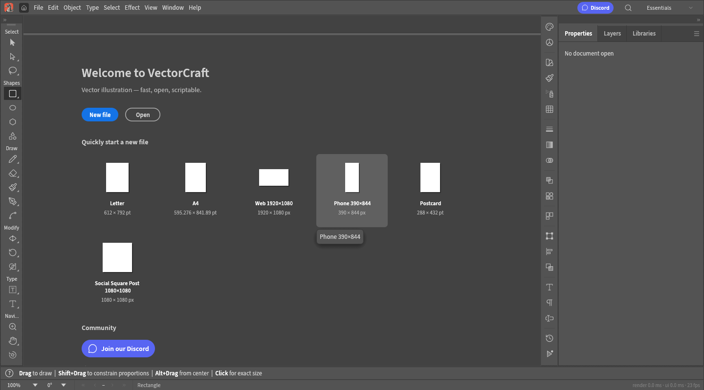

[Original project](https://github.com/storytold/vectorcraft) · [Original UI build and evidence](docs/vectorcraft-original-ui-preview.md). Browser-local preview; original server/provider integration pending.

### PdfCraft — ArtCraft / storytold

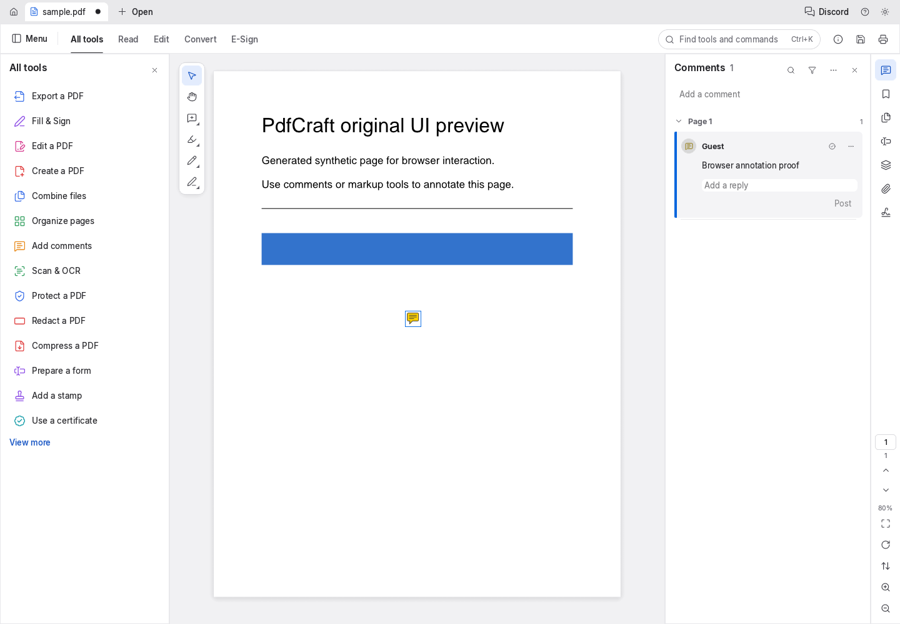

[Original project](https://github.com/storytold/pdfcraft) · [Original UI build and evidence](docs/pdfcraft-original-ui-preview.md). Browser-local preview; original server/provider integration pending.

### DesignCraft — ArtCraft / storytold

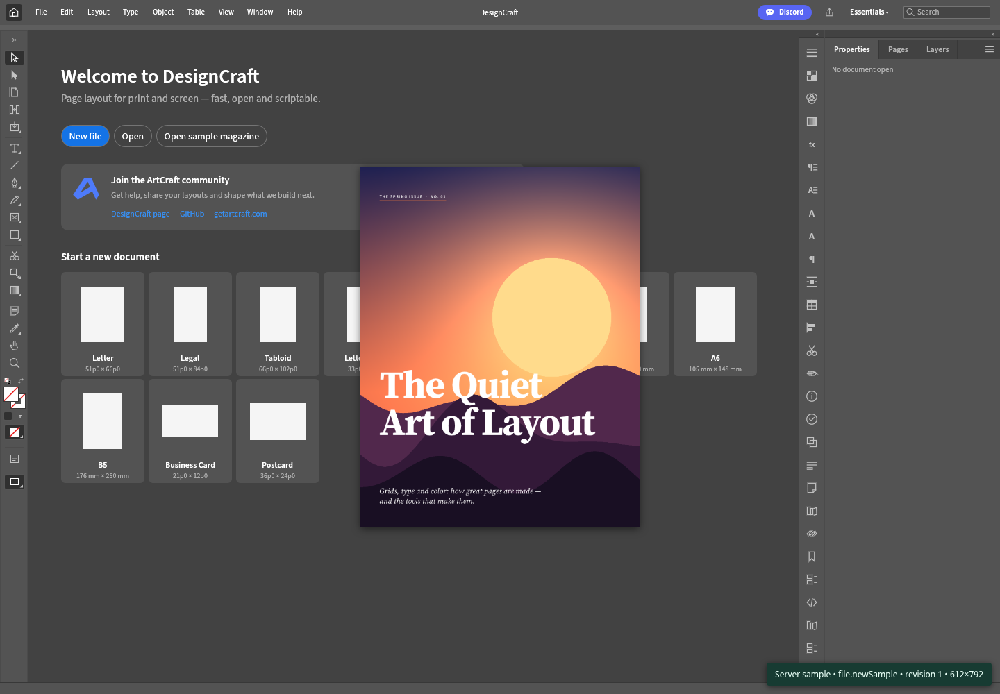

[Original project](https://github.com/storytold/designcraft) · [Server bridge scope and evidence](docs/designcraft-par03-sample-bridge.md). Allowlisted `file.new`, graphic `frame.create`, `selection.set`, Type Tool caret and text edits run on the owned worker; selection ACK/read-model proof is linked in [alpha.39 evidence](docs/evidence/designcraft-par03-selection-set-local.md). Providers, real folder permission, laptop write ACK/recovery and full parity remain pending.

### LightCraft — ArtCraft / storytold

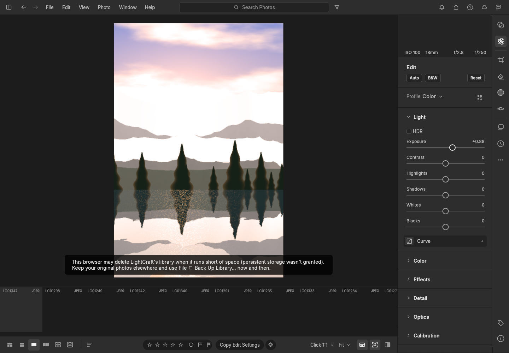

[Original project](https://github.com/storytold/lightcraft) · [Original UI build and evidence](docs/lightcraft-original-ui-preview.md). Browser-local preview; full server/provider acceptance and some optional font assets pending.

### FilmCraft — ArtCraft / storytold

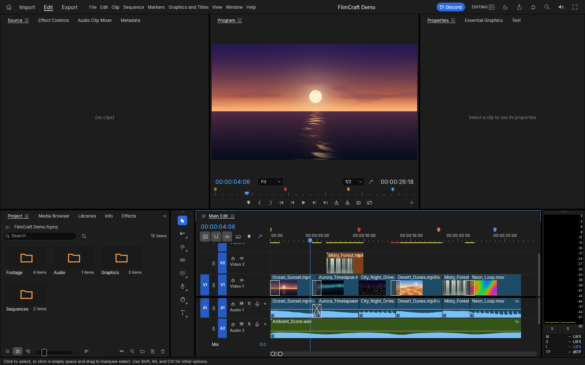

[Original project](https://github.com/storytold/filmcraft) · [MKV import evidence](docs/filmcraft-mkv-import-handoff.md). Reviewed original-UI patch; server media/proxy/render/provider integration pending.

### EffectCraft — ArtCraft / storytold

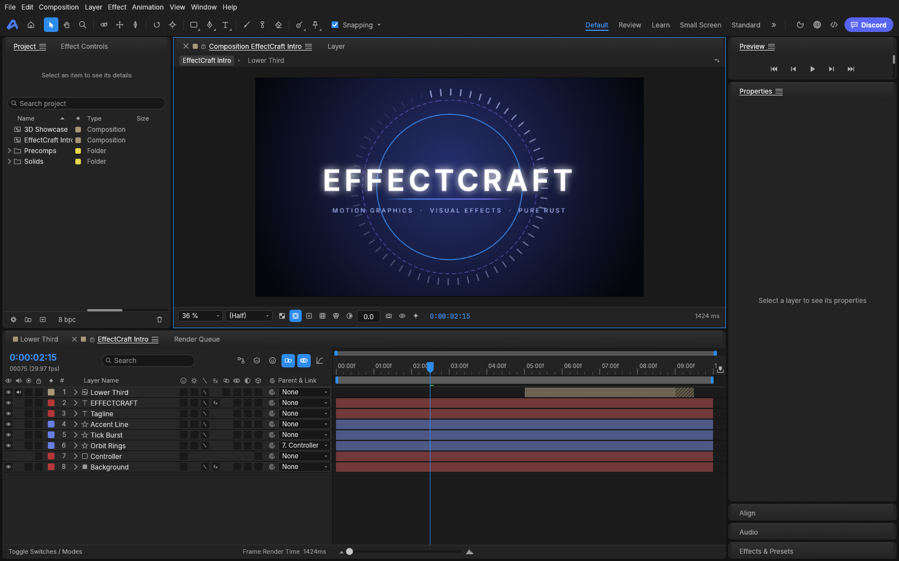

[Original project](https://github.com/storytold/effectcraft) · [Original UI build and GPU limitations](docs/effectcraft-original-ui-preview.md). A rendered demo does not establish complete GPU-worker or server-render acceptance.

## Installation

### Portable prototype downloads

1. Open [GitHub Releases](https://github.com/vedranius/creative-workspace/releases) and choose a **published** release. Read its scope and verify the SHA256 sidecar.
2. Extract into a writable folder. Run `start.cmd` on Windows, `start.command` on macOS or `./start.sh` on Linux.
3. Open [http://127.0.0.1:8788](http://127.0.0.1:8788). An occupied port fails startup; set a free `PORT` explicitly.

| Target | Requirements | Download scope |
| --- | --- | --- |
| Linux x64 | glibc 2.35+ | Node 24, gateway, four native prototype engines, licenses/manifests/checksums. |
| Windows x64 | Microsoft Visual C++ 2015–2022 x64 runtime | Same prototype scope; unsigned. |
| Apple Silicon macOS | macOS 14+ | Same prototype scope; unsigned. |

The four bundled engines are PhotoCraft, PdfCraft, VectorCraft and DesignCraft. **These public bundles do not contain the complete original ArtCraft suite, RapidRAW, LightCraft or a native mount helper.** Intel Mac and Linux/Windows ARM bundles are not offered. Original UI packages require separate registration. GitHub's automatically generated source archives are not ready-to-run bundles. [Detailed requirements, checksums and upgrade steps](docs/releases.md).

### Run the gateway from source

Requires Git and Node.js 24 or later. On Linux/macOS:

```sh
git clone https://github.com/vedranius/creative-workspace.git
cd creative-workspace
npm ci
mkdir -p workspaces/photography
npm start
```

On Windows PowerShell use `New-Item -ItemType Directory -Force workspaces/photography` instead of `mkdir -p`; the remaining commands are the same. Open [http://127.0.0.1:8788](http://127.0.0.1:8788). This starts the **control panel**. Install/register an application before expecting its launcher to be available.

State defaults to `data/`; allowed project roots default to this checkout's `workspaces/`. `DATA_DIR` changes the state location. `WORKSPACE_ROOTS` accepts absolute server roots separated by `:` on Linux/macOS or `;` on Windows. The panel can assign an app folder only inside those roots. Each app gets its own default folder when needed.

### Install owned engines and original interfaces

- **RapidRAW:** [independent Linux installer and launcher](engines/rapidraw/README.md), using `npm run engine:rapidraw:install` then `npm run engine:rapidraw:start`. This creates a separate managed engine; it never attaches to the user's existing RapidRAW Web.
- **Native prototypes:** `npm run engine:photocraft:install`, `npm run engine:pdfcraft:install`, `npm run engine:vectorcraft:install`, `npm run engine:designcraft:install`. See their `engines/<app>/README.md` for build dependencies and exact scope. LightCraft's separate foundation has its own [guide](engines/lightcraft/README.md).
- **Original ArtCraft UIs:** build the exact known upstream web pin into an independent static directory, then register it. FigCraft v0.6.0 uses `npm run ui:figcraft:build -- <pinned-source> <static-output> <package-root>`; this is browser WASM and does not wire file open/save or a server adapter. Registration requires Git; serving an already registered package does not require Git. It checks source identity, licenses, manifests and asset hashes; it does not build arbitrary repositories automatically.

```sh
# PhotoCraft example: use the exact pin and build recipe in its preview guide.
npm run ui:install -- photocraft /path/to/pinned/photocraft /path/to/photocraft/static-output
```

Set `CW_ORIGINAL_UI_DIR` to the same registration root before starting the gateway; default is `DATA_DIR/original-ui`. FilmCraft and DesignCraft require their exact reviewed patch variants, not an unpatched arbitrary build. [Registration guide](docs/studio-original-uis.md) · [FilmCraft variant](docs/filmcraft-mkv-import-handoff.md) · [DesignCraft variant](docs/designcraft-par03-sample-bridge.md).

For a suitable Linux on-demand host, install the separate helper with `npm run storage:install`; read [host/browser requirements](engines/storage/README.md). This does not grant browser folder permission or complete original-UI provider integration.

### Docker Compose

```sh
cp .env.example .env
# Set WORKSPACE_AUTH=user:password in .env before starting.
mkdir -p workspaces/photography
docker compose up --build -d
```

Windows PowerShell: use `Copy-Item .env.example .env` and `New-Item -ItemType Directory -Force workspaces/photography`. The rest is the same. Open [http://127.0.0.1:8788](http://127.0.0.1:8788). The container sees the bind-mounted files at `/app/workspaces`; persistent state uses the `workspace-state` volume. Ensure its non-root user can read/write your project folders.

**Current Docker scope is the gateway only.** It does not bundle creative engines, original UI packages or FUSE. Engine-enabled Docker is planned. Compose binds localhost, drops capabilities and needs neither privileged mode nor a Docker socket.

### Access from anywhere and upgrade

Use HTTPS through a reverse proxy or a Cloudflare Tunnel/Access deployment. Set `WORKSPACE_AUTH=user:password`; authentication is mandatory when listening beyond loopback. Secure-context/browser folder permissions still apply. Cloudflare Access complements the gateway's authentication and root checks. Keep tokens/passwords in server environment configuration; the optional `GITHUB_TOKEN` is used only server-side for release checks.

Save documents before stopping the server. Back up `data/` and your project roots. Extract upgrades into a new directory, point `DATA_DIR`/`WORKSPACE_ROOTS` to the backed-up data, and reopen a known document before retiring the old installation. Do not replace a running bundle or reload an unsaved original UI. Automatic migration/rollback is pending.

## Original projects and authors

Creative Workspace by [vedranius](https://github.com/vedranius) integrates independent upstream projects. It is **not authored as a replacement for their creative applications** and is not presented as an official ArtCraft product. Their original names, UI and licenses are retained.

| Project / author | Original repository | Pinned revision | License at the recorded pin |
| --- | --- | --- | --- |
| RapidRAW — **CyberTimon** | [CyberTimon/RapidRAW](https://github.com/CyberTimon/RapidRAW) | Via the pinned web fork below | AGPL v3; retain original notices. |
| RapidRAW Web — **vedranius**, derived from CyberTimon/RapidRAW | [vedranius/rapidraw-web](https://github.com/vedranius/rapidraw-web) | `38ddc8af` | AGPL-3.0-only |
| PhotoCraft — **ArtCraft / storytold** | [storytold/photocraft](https://github.com/storytold/photocraft) | `29d5f791` | MIT OR Apache-2.0 |
| VectorCraft — **ArtCraft / storytold** | [storytold/vectorcraft](https://github.com/storytold/vectorcraft) | `96344f07` | MIT OR Apache-2.0 |
| PdfCraft — **ArtCraft / storytold** | [storytold/pdfcraft](https://github.com/storytold/pdfcraft) | `9ccf77bd` | MIT OR Apache-2.0 |
| DesignCraft — **ArtCraft / storytold** | [storytold/designcraft](https://github.com/storytold/designcraft) | `a127c6d5` | MIT OR Apache-2.0 |
| LightCraft — **ArtCraft / storytold** | [storytold/lightcraft](https://github.com/storytold/lightcraft) | `9e6c4c6f` | MIT OR Apache-2.0 |
| FilmCraft — **ArtCraft / storytold** | [storytold/filmcraft](https://github.com/storytold/filmcraft) | `4e2d0bc2` | MIT OR Apache-2.0 |
| EffectCraft — **ArtCraft / storytold** | [storytold/effectcraft](https://github.com/storytold/effectcraft) | `9a7d3e76` | MIT OR Apache-2.0 |

Explore [ArtCraft's application collection](https://getartcraft.com/apps) and the [storytold repositories](https://github.com/storytold). Source pins and workspace changes live in engine manifests, original UI manifests, `patches/` and the linked evidence guides. The shared file provider is explicitly derived from RapidRAW Web, with its source header and bundled AGPL text preserved.

**About forks and discovery:** this repository is an integration project, not a GitHub fork of all the listed repositories. GitHub fork ancestry connects a fork to one upstream repository; a multi-project integration cannot have seven simultaneous “forked from” parents. Attribution links identify every source here, but do not automatically create reverse links from their repos. The repository description and topics help GitHub search; upstream acknowledgement or inclusion in their directories requires their maintainers' participation. [GitHub's fork model](https://docs.github.com/en/pull-requests/reference/forks). [Repository description/topics setup](docs/github-discovery.md) records the proposed metadata and current administration-permission limitation.

The six new entries are authored by **ArtCraft / storytold**: [FigCraft](https://github.com/storytold/figcraft), [WordCraft](https://github.com/storytold/wordcraft), [SoundCraft](https://github.com/storytold/soundcraft), [DeckCraft](https://github.com/storytold/deckcraft), [CADCraft](https://github.com/storytold/cadcraft) and [GridCraft](https://github.com/storytold/gridcraft). WordCraft, GridCraft, DeckCraft, CADCraft, FigCraft and SoundCraft have reviewed exact-pin original browser UI previews with MIT/Apache and separate ArtCraft brand license provenance. Their document/design processing remains browser WASM; server/provider integration and full parity remain pending. SoundCraft audio processing remains in browser WASM; server engine/provider integration and parity are pending. See [SoundCraft preview evidence](docs/soundcraft-original-ui-preview.md). Upstream code remains under its own licenses. See [GridCraft preview evidence](docs/gridcraft-original-ui-preview.md), [DeckCraft preview evidence](docs/deckcraft-original-ui-preview.md), [CADCraft preview evidence](docs/cadcraft-original-ui-preview.md) and [the expansion plan](docs/artcraft-expansion.md).

## License and use

Creative Workspace is **AGPL-3.0-only**, with the full terms in [LICENSE](LICENSE) and a plain-language guide in [LICENSE.md](LICENSE.md). Personal, educational, business and commercial use are permitted; Creative Workspace adds no restriction on the purpose of use and charges no license fee. AGPL source/notice obligations still apply when distributing covered software or operating a modified network service. “Open” does not mean removing those obligations.

Included applications, libraries, fonts and assets retain their original authors' licenses; this repository does not relicense them. Dual-license `MIT OR Apache-2.0` means a choice between those terms for the relevant upstream code, subject to its notices and dependencies. Your own photos, videos, documents and ordinary creative outputs do not become AGPL merely because you use the software. Embedded third-party assets may carry separate terms. See the [license and attribution guide](LICENSE.md).

## Development and next steps

```sh
npm run check
npm test
npm run release:validate
```

Next: extend the original DesignCraft server read-model, commands and editing flow; connect common providers and acknowledged save/reopen; repeat for the other original apps; stage paired upstream updates; then accept complete Actions OS bundles and engine-enabled Docker. Control-panel installation jobs, multi-user permissions, resumable transfer, cache quotas and automatic conflict-safe recovery remain planned.

[Complete original-app plan](docs/original-app-port-plan.md) · [Roadmap](docs/roadmap.md) · [Architecture](docs/architecture.md) · [Adapter contract](docs/adapter-contract.md) · [Validation](docs/validation.md) · [Development handoff](docs/development-state.md) · [AI/MCP plan](docs/ai-assistant.md)
