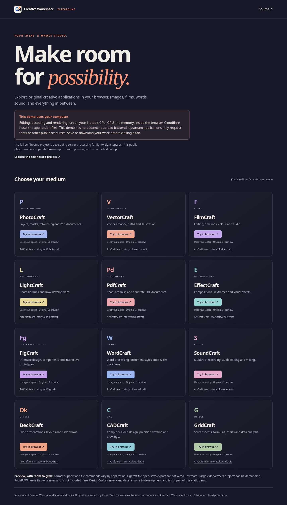
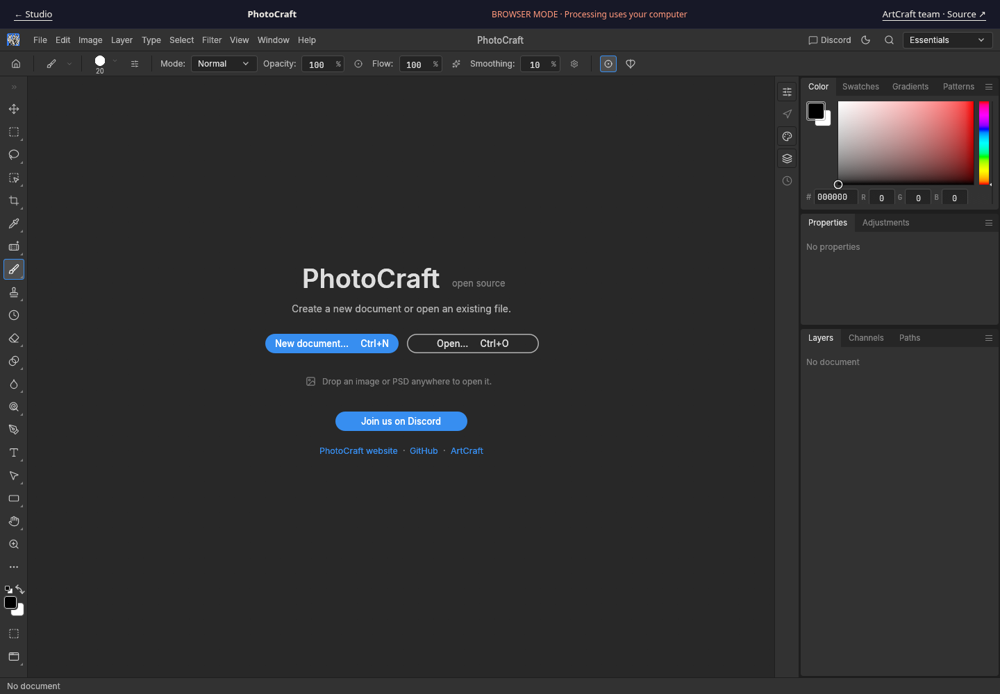

# Public browser-processing playground

This independent static demo of twelve original ArtCraft interfaces runs while the development computer is off. **The visitor's CPU, GPU and RAM perform editing, decoding, rendering and export inside the browser.** This explicitly labelled alternative demo mode preserves the Creative Workspace goal: server processing with original browser interfaces.

Each app requires an acknowledgement before its original iframe loads and retains a browser-mode label. The original editor UI and decoded WASM bytes are preserved. The portal uses Creative Workspace branding, links upstream repositories, retains licenses/provenance and makes no endorsement claim. Content Security Policy restricts connections to this same origin and browser-local blobs. There is no document-upload backend, analytics, private-server credential or local-studio tunnel. Save/download work before leaving. Browser storage and file permissions depend on the upstream app/browser; the demo makes no common-provider/on-demand/server-save claim.

RapidRAW requires an owned backend and is excluded. DesignCraft's incomplete server candidate is excluded. FigCraft upstream file open/save/export remain unwired. Large media may overwhelm a weak laptop; broad format, audio and export parity remain unverified. This is a UI playground, not a fully accepted suite. There is no enforced 5–10 minute limit: browser computation uses no shared editing-server session, and an honest hard cutoff requires another service design.

## Build and publish

Version: `0.2.0-alpha.57`, prototype/prerelease candidate. Sources: `cloudflare/demo/` and `scripts/build-cloudflare-demo.mjs`. Use an **empty output directory** and a verified original-UI registry containing the twelve reviewed packages. No engine rebuild is needed. The builder rejects unexpected source/patch identity, path traversal, symlinks in listed assets, bad size/hash and assets above 25 MiB. Only listed public assets are exported, never workspace trees. WASM is stored as explicit `.wasm.gz` assets below Pages’ per-file limit. After consent, a browser Service Worker intercepts only an exact generated WASM URL allowlist and returns gzip-decoded bytes as `application/wasm`; original HTML, JS and SRI attributes stay untouched. It does not intercept document requests, upload files or cache documents. A first experiment using Content-Encoding headers was rejected after remote checks found double compression. Current-browser Service Worker and DecompressionStream support are required; failures remain visible at the launch screen. Remote SHA-256 and browser verification are required.

```sh
node scripts/build-cloudflare-demo.mjs /absolute/path/to/verified-ui-registry build/cloudflare-demo
# Existing authenticated Wrangler 4.151.0; never print its credentials.
node /absolute/path/to/wrangler/bin/wrangler.js pages deploy build/cloudflare-demo --project-name creative-workspace-demo --branch main
```

`cloudflare/wrangler.jsonc` records the independent Pages project, date and account. The Meshtastic project is untouched. Initial deployment uses its already installed Wrangler 4.151.0 with explicit project name, without upgrading or bundling account credentials. Auth requires Pages write. Generated assets live in ignored `build/`. OS artifacts continue to come from GitHub Actions under their separate acceptance gates.

References: [Pages headers](https://developers.cloudflare.com/pages/configuration/headers/), [Pages limits](https://developers.cloudflare.com/pages/platform/limits/).

## Published and verified

Public URL: https://creative-workspace-demo.pages.dev/

Final source-bound deployment: https://1157ac0e.creative-workspace-demo.pages.dev/ at product commit `4efc0cfe8211f779d39ed497c44fe24351b1bc5b` (2026-10-17), with zero changed asset bytes from browser-verified deployment https://60bcb383.creative-workspace-demo.pages.dev/. All twelve original interfaces launched through the public portal; explicit consent precedes iframe load, the persistent laptop-processing label remains visible, and original decoded WASM SHA-256 values match every pinned package. All twelve canvases are non-uniform and cross-origin isolated. No page errors or failed requests were recorded. The smoke assertion for FilmCraft was corrected to ignore its upstream cache-busting query, then FilmCraft alone was rerun successfully. This is launch/render/transport evidence, not broad editing/save/format acceptance. [Browser report](evidence/cloudflare-demo-alpha57/browser.json).





The other eleven application screenshots are retained alongside that report. Local verification: 83 tests passed, `npm run check`, release validation and diff check passed. A regression test proves that the browser transport decodes only the exact WASM allowlist and does not intercept document, POST or other-origin requests. No protected local service was restarted.

GitHub source is pushed normally at `4efc0cf`. Checks run `39040178445` passed Linux and macOS while Windows was still running at handoff. Build/release `39040178352` is pending behind alpha.56 `39037838837` (original-designcraft job still running). No alpha.57 tag/release assets are claimed yet. The continuation must inspect these exact runs and verify immutable draft/tag plus all downloaded assets/checksums after success.
