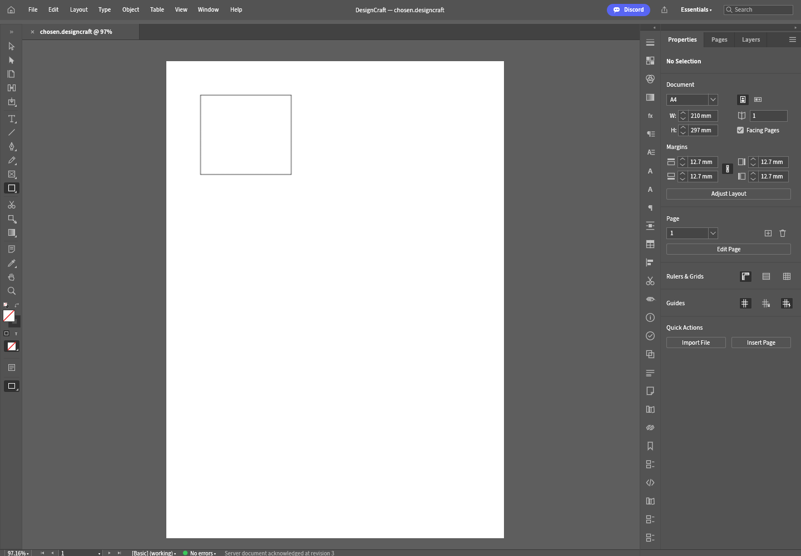

# Original DesignCraft Open — single-file copy-first candidate

Creative Workspace alpha.24 (verification correction alpha.25) connects the pinned original DesignCraft welcome Open control and File/Open shortcut to the browser's native file chooser. The source remains upstream `a127c6d5c3576972bbd60445f26d893db071eef3` with a reviewed portability/backend patch; it is not a replacement editor.

The browser host accepts one `.designcraft` file up to 64 MiB. It sends the selected File object through fetch without reading/parsing its archive into a client document. The common `receiveFile` transfer primitive receives bounded bytes under an `imports/<unique-id>/` path in the **existing session's server root**. Changing the panel's application workspace during the chooser cannot redirect this session's input. Existing copies are never overwritten, foreign sessions/Origins/auth failures are rejected, and inputs are not written through a laptop share.

Only a complete path/byte-count/session/mode acknowledgement queues the original `file.open` action. The owned native worker resolves that provider-relative path, parses the native publication, and returns its canonical snapshot, clean state, filename and bounded server PNG. Original panels/canvas consume that ACK; no local binary-document open runs. An already open document must be saved/closed before another open. Cancellation, rejected size/name and failed transfer cannot trigger native open or mirror hydration.

This is explicitly **single-file copy-first**, with the laptop original and retained server input copy separate. It does not connect the original UI's folder-mode choice, on-demand/hybrid folder permissions, linked-media relinking, other formats or multiple spreads. Common `file.open` RPC also retains the existing selected-share readiness/focus guards, but that is not a browser permission or on-demand acceptance claim. Save destination/write ACK, reopen/recovery and complete original-app parity remain pending. DesignCraft stays planned; no live studio/package/session is replaced.

## Build and verification

The active candidate pin/digest is [host-canvas.json](../engines/original-ui/designcraft/host-canvas.json); its [source patch](../patches/designcraft/a127c6d5/par-03-file-open-candidate.patch) includes the original Open caller, asynchronous pending/cancel/error handling and streamed provider host service.

Use a clean pinned source checkout with `npm run ui:designcraft:host -- <clean-source> <new-assets>`. The builder verifies the exact reviewed canonical source, compiles only a disposable copy with Rust 1.99/Trunk 0.21.14, and retains source provenance/licenses. Local compilation uses the existing cache and low-impact wrapper (one Cargo job, max two CPUs, nice 10).

`scripts/smoke-designcraft-file-open-candidate.mjs` uses a disposable loopback gateway/browser/owned worker. Set `CW_DESIGNCRAFT_BINARY`, `CW_DESIGNCRAFT_UI_ASSETS`, `CW_PLAYWRIGHT_MODULE`; optionally `CW_BROWSER_EXECUTABLE`, `CW_PAR03_REPORT`, `CW_PAR03_SCREENSHOT`. It creates a native fixture with the real engine, chooses the fixture through the actual original control/browser file chooser, checks the scoped transfer acknowledgement and native open, edits/undoes, verifies originals remain byte-identical, and tests cancellation, failed upload and over-limit rejection before upload. It does not replace actual user folder permission testing.

## Local acceptance evidence

The optimized pinned-source build passes with WASM SHA256 `c0faecd655376424152e816f51eba9f5c7fb64d4ea2d75ab3e35938ce118cfae`. Gateway/provider suite passes 52/52; targeted auth/Origin/session/collision/path tests pass.

One real Chromium context chooses the original Open control, cancels once, then selects a 2,847-byte native fixture created by the real engine. The transfer ACK precedes native `file.open` revision 1/clean state, despite the panel workspace changing during selection. The original filename and existing object appear in the original UI. Original Rectangle Tool editing reaches revision 2; Ctrl+Z reaches revision 3 and restores the opened snapshot/server render. Hashes of laptop original and retained server copy remain unchanged. Upload failure produces no native open/hydration; a sparse file above 64 MiB is rejected before any upload. Screenshot pixel gate passes (532,934 bright pixels, at least 64 colors), with no page exceptions.

[Browser report](evidence/designcraft-file-open-browser.json) · [Screenshot](evidence/designcraft-file-open-browser.png). The smoke observes actual gateway HTTP JSON receipts directly because large-WASM loading can evict Chrome inspector response bodies; no application response or engine behavior is stubbed on the successful path. Only the negative transfer case is deliberately fault-injected. This is not real folder-permission/on-demand acceptance or a completed editor.

## Release and installation

Alpha.25 requires Actions builds, all OS checks, the original Open browser job, an immutable new tag, a draft and six archive/checksum pairs before download claims. The host-canvas candidate archive remains separate from registered original UI packages; do not copy it over a live studio or an unsaved document. The three native prototype bundles, legacy preview and FilmCraft preview retain their existing limited acceptance. No complete creative-suite claim follows from this candidate.

Next after release verification: source/provider selection in the original host workflow, separate destination/retention, original save-copy with destination ACK, then reopen/recovery and full parity. Keep provider and upstream-update gates intact.

The initial alpha.24 macOS fixture compared the uncanonicalized temporary-directory alias with the correctly canonicalized engine input. Alpha.25 uses `realpath` in that assertion. Application behavior/source patch/WASM/browser evidence are unchanged; final three-OS Checks and draft assets remain pending.

Publication checkpoint 2026-10-13: commits `8f3fcdd` (feature) and `83276a9` (alpha.25 canonical macOS verification) are pushed; [Checks 38314679443](https://github.com/vedranius/creative-workspace/actions/runs/38314679443) passed all three OS. [Alpha.25 build/release 38314678319](https://github.com/vedranius/creative-workspace/actions/runs/38314678319) is pending behind alpha.24. Final tag/draft/download assets remain unverified.
