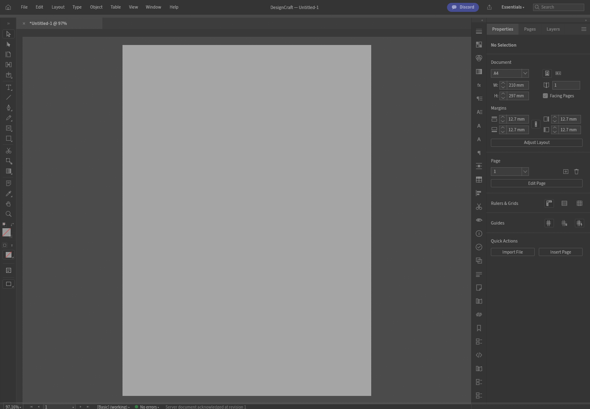

# DesignCraft original preset → server canvas

Creative Workspace alpha.19 adds a bounded candidate based on upstream DesignCraft `a127c6d5c3576972bbd60445f26d893db071eef3`. It retains the original `DesignApp` and its A4 welcome-screen preset card. This is a partial port; DesignCraft remains planned.

The actual preset click queues original `file.new` and its preset parameters. The owned gateway/worker creates the document and returns a revisioned canonical snapshot, dirty state and bounded server PNG. The browser validates the ACK, snapshot and same-session preview before hydrating a read-only original UI mirror. The original canvas displays the server PNG as an egui texture; its local document renderer and pointer/tool path are bypassed. Image decoding and displaying the preview remain browser presentation work.

Only this first document action is bridged. Other original commands, tools and file imports are unavailable rather than silently executing locally. The mirror refuses engine command execution, the original UI is disabled while pending/after hydration, and unbridged shortcuts and drops are blocked. Native workers retain their normal command behavior. This does not complete editing, file providers, destination ACK, save/reopen, recovery, upstream update activation or full UI/function parity.

## Original Rectangle Tool edit candidate

The separate [PAR-03 `frame.create` candidate](par-03a-handoff.md#current-edit-action-candidate-2026-10-12-not-accepted) keeps the original `DesignApp` and adds one real edit path: original Rectangle Tool `M` shortcut + drag → ordered server `frame.create` → ACKed canonical mirror and server PNG. Build and behavior evidence are in the [native/build report](evidence/designcraft-par03-frame-create-candidate-native.json) and [Chromium report/screenshot](evidence/designcraft-par03-frame-create-candidate-browser.json). Exact pin, patch SHA and limitations are in the [candidate manifest](../engines/original-ui/designcraft/frame-create-candidate.json).

This candidate is not registered or activated. Other original actions/tools, provider paths, destination ACK/save/reopen/recovery and complete parity remain unfinished; catalog and release availability stay planned.

## Reproduce without touching a live studio

Use a new clean checkout at the exact upstream pin, Rust 1.99.0 with `wasm32-unknown-unknown`, and checksum-pinned Trunk 0.21.14. `npm run ui:designcraft:host -- <clean-source> <new-assets>` checks the exact reviewed source patch/digest before and after building. The candidate manifest is [host-canvas.json](../engines/original-ui/designcraft/host-canvas.json). It is separate from the currently registered immutable original-UI package.

Run `scripts/smoke-designcraft-host-canvas.mjs` with `CW_DESIGNCRAFT_UI_ASSETS`, `CW_DESIGNCRAFT_BINARY`, and `CW_PLAYWRIGHT_MODULE`; optionally set `CW_BROWSER_EXECUTABLE`, `CW_PAR03_REPORT` and `CW_PAR03_SCREENSHOT`. It serves only its candidate on a disposable loopback port, keeps gateway Origin/session checks, clicks the actual preset card, verifies the worker response/server PNG/canvas revision, tries unbridged gestures and shortcuts, injects a preview failure to prove no premature hydration, then closes its own worker and browser. It does not exercise a real laptop folder permission or save acknowledgement.

## Local evidence (2026-10-12)

- Original A4 card center `[778,467]` at 1440×1000 caused actual `file.new` and preset `A4`; ACK revision 1, canonical snapshot 6,873 bytes, 595×842 server PNG.
- Original canvas/panels are visible; screenshot pixel gate counts 524,966 bright pixels and at least 64 distinct colors. Unbridged gestures/shortcuts do not generate another RPC or advance the revision. An injected 503 preview failure leaves revision 0 and no hydrated/rendered mirror.
- No uncaught browser errors on the successful path or page exceptions in the failure path. [Report](evidence/designcraft-par03-host-canvas.json) · [Screenshot](evidence/designcraft-par03-host-canvas.png).
- Local candidate WASM SHA256: `09563e9daa73ab7a630b95ed701331ea95bee86ab16e4d05a801fbf16316ac97`. `npm run check`, 48/48 `npm test`, release validation and exact source-diff/digest checks pass.
- Initial QA exposed two environment issues: Chromium Unix-socket paths exceeded the limit with the long project TMPDIR, and the old SwiftShader launch flag produced a uniformly dark screenshot. A short symlink to disk-backed scratch and ANGLE/SwiftShader launch flags fixed them; visual pixel validation now rejects the dark result. Local bytes are not release assets.

## Installation and release scope

Actions builds and browser-verifies an additional `designcraft-host-canvas-candidate.tar.gz` archive and SHA256 sidecar. This is a review/verification artifact, not a registered editor or a complete cross-platform creative bundle. Do not copy it over a running original-UI installation. Product alpha.20 remains draft until its actual Actions artifacts are checked; the earlier three native prototype bundles and two original UI previews retain their documented limitations. Six archives and six sidecars are expected for this draft.

Local build/QA uses a disk-backed temporary directory and the host low-impact wrapper (one Cargo job, at most two CPUs, nice 10). Previously downloaded release archives were preserved on disk to free about 1.1 GB of `/tmp` tmpfs. Protected application services and documents were not restarted.

Next: connect an actual original editing action through the same ordered pending/ACK boundary, refresh the canonical mirror and server canvas at the new revision, then implement common file-provider destination/retention/save ACK/reopen/recovery. Keep availability planned until acceptance passes.

Alpha.20 also includes `LICENSE-CREATIVE-WORKSPACE` and `UPSTREAM.txt` in the candidate archive. Its source patch and local browser/WASM evidence are unchanged from alpha.19. The host token lacks Actions cancellation permission (403); no tag/release is overwritten. Verify the final alpha.20 pipeline and its twelve assets separately.

Publication checkpoint: source/metadata commit `ee69c299aa6aee0d5bb907f132b87a0e8f5d4f6a` is pushed, three-OS [Checks 38256341158](https://github.com/vedranius/creative-workspace/actions/runs/38256341158) pass. [Alpha.20 build/release 38256341061](https://github.com/vedranius/creative-workspace/actions/runs/38256341061) is pending behind the earlier alpha.19 build. No alpha.20 tag or downloadable asset set has been verified yet. Continue with tag/draft/twelve-asset checks before any release availability claim.
