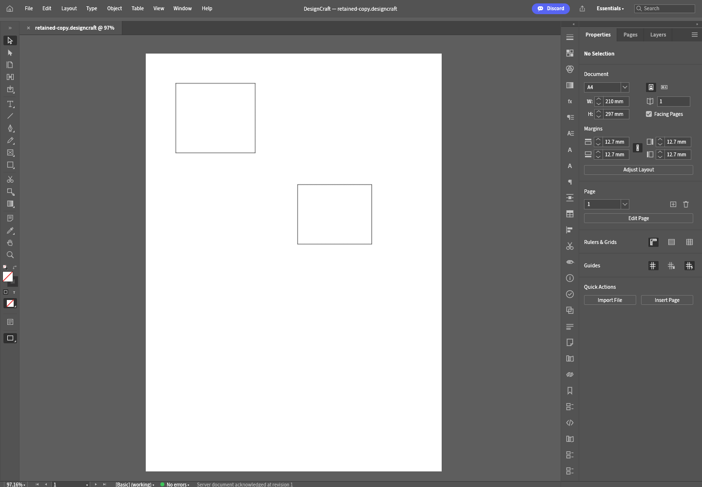

# Creative Workspace v0.2.0-alpha.30 release verification

Verified 2026-10-13 using the private host GitHub helper, authenticated as `vedranius`.

- Immutable tag `v0.2.0-alpha.30` points to `c7ac0b885b59ac6f0feac3766fc5e044aa8b80cb` (selected-filename preservation fix).
- [Checks 38377532728](https://github.com/vedranius/creative-workspace/actions/runs/38377532728) and [Build/release 38377532841](https://github.com/vedranius/creative-workspace/actions/runs/38377532841) completed successfully: contract, all 12 native targets, FilmCraft original browser regression, DesignCraft original browser/worker candidate, three target bundle jobs and publish.
- Release ID `411534089` is a **draft prerelease**. Six Actions-built archives and six SHA256 sidecars were downloaded; all checksums matched. Draft assets are authenticated downloads, not a public installation/availability claim.
- Linux x64, Windows x64 and macOS arm64 bundle manifests match alpha.30 and the tagged source commit. Embedded Node 24, four owned engine binary digests/pins/licenses, startup/homepage/health evidence and native open/edit/save/reopen smoke records were checked. These native prototype bundles do not prove original UI/provider parity on all OSes.
- Registered preview archives have matching file sizes/digests, upstream pins and source patch digests. The separate, unregistered host-canvas candidate carries pin `a127c6d5c3576972bbd60445f26d893db071eef3` and patch SHA256 `c2d268cf6ab89a811215a119df68132ff9608e55e5f72ddf1eb1301359caa555`. No candidate was activated in a user session.

| Actions-built asset | SHA-256 |
| --- | --- |
| `creative-workspace-0.2.0-alpha.30-darwin-arm64.tar.gz` | `035a6c0bc3d619ce2efe13ac76d513fd163f1fcc83653cead97be747b0239b16` |
| `creative-workspace-0.2.0-alpha.30-designcraft-host-canvas-candidate.tar.gz` | `228a10b9b80222147fe05a9fc7b99cde5fbf1f590d55670669b875b61bcc032c` |
| `creative-workspace-0.2.0-alpha.30-designcraft-par03-preview.tar.gz` | `a366fe3932d3b2284f2aff89861d027719fa7d8f8a1cc3019de7f5f52a08b15b` |
| `creative-workspace-0.2.0-alpha.30-filmcraft-original-ui.tar.gz` | `a53bc0e5a91e2294c0cd9b8f0efb122774a35a34b51ac022cb215b22642a946c` |
| `creative-workspace-0.2.0-alpha.30-linux-x64.tar.gz` | `85061fc06482d862870e73c08a7dd21f403c27a03303fd8353a31f98c66fa0b1` |
| `creative-workspace-0.2.0-alpha.30-win32-x64.zip` | `414bb2cd472f2088157488267d3df72cc677c9603df5f5572f7743d0f63a36db` |

## Original browser proof

Downloaded artifact `designcraft-par03-browser-evidence` from the same successful run. [Host-canvas report](designcraft-alpha30-host-canvas.json) proves original A4 → Rectangle Tool → Undo → Redo → Undo at server revisions 1–5, canonical snapshot/server PNG restoration, blocked unbridged commands, failure without hydration, visible canvas and zero uncaught errors.

[Open/Save Copy report](designcraft-alpha30-file-open.json) proves original Open → session-rooted copy-first receipt → native `file.open`, selected filename presentation, edit/Undo, atomic server-workspace Save a Copy ACK, preserved source dirty/name state, no overwrite, and reopening the retained copy through the original chooser. Cancellation, failed upload, pre-upload size rejection and unchanged original input also pass. Screenshot visually inspected: original DesignCraft panels, reopened `retained-copy.designcraft` and visible edited page.

**Limits:** the test context hides `showOpenFilePicker` to exercise the original HTML file-input fallback. It does not prove File System Access folder permissions or a laptop write ACK. Native one-spread documents and server/workspace retention only; on-demand/hybrid folder binding, laptop destination/recovery and full original tool parity remain pending. Keep DesignCraft planned and the release draft.

**Next bounded task:** bind the original host session and Save Copy dialog to an explicitly selected common provider; offer independent destination/retention choices, preserve existing server copy-first behavior, and fail closed without a read/write laptop share. Then prove real folder permission/write ACK/reopen/conflict/disconnect/recovery. Local host tools were verified in MAIN: `/dev/fuse`, pinned Trunk, Chromium and Playwright exist; mounting/permission acceptance remains to be tested. Use the private host handoff, existing worker and low-impact build wrapper; preserve live sessions and untracked `engines/filmcraft/`.
