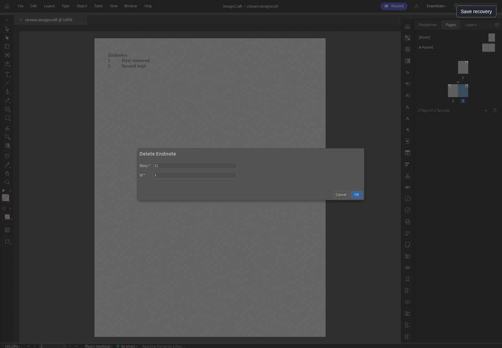
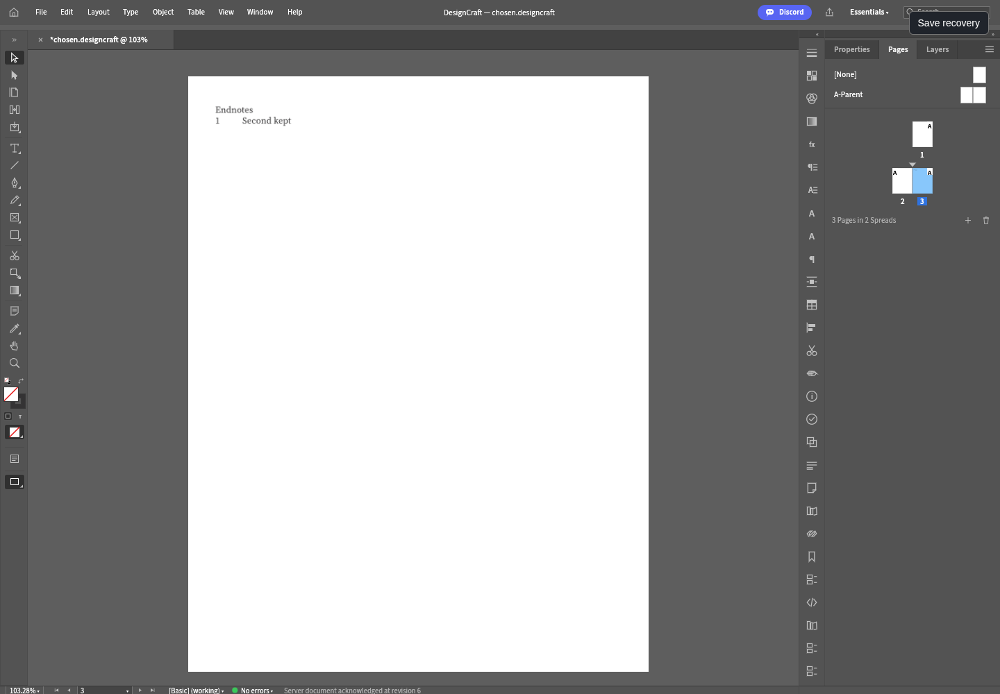

# Original DesignCraft Delete Endnote — alpha.76 candidate

The original registered `endnote.delete` command has label **Delete Endnote**, with no static menu or shortcut. Hosted Quick Apply includes this admitted registry command while a document is open and idle, then uses the existing generic story/id form. Standalone filtering and static menus remain unchanged. Original JSON field parsing and empty-field omission remain.

Gateway/native admission accepts only positive wasm32 story/note IDs, with no extra parameters. Before the real Session or Undo history changes, native preflight bounds the current document/endnote listing, resolves the target and its ordinal body reference, executes the unchanged original command on an isolated COW Session, and bounds its resulting document/listing/canonical JSON. Malformed, unknown, missing-reference and excess-formatting candidates are refused before mutation. These are bounded prototype checks, not a claim of complete memory protection.

Native selection proof uses the existing object selection; browser Open/page selection uses an empty text selection. Broader caret/range remapping remains outside this bounded acceptance.

The original command removes one body reference and its note, regenerates the listing, and preserves the remaining note, page/listing identity and original selection. Last-note behavior remains the unchanged original engine behavior, without invented page cleanup. The original form retains its target during pending/failure; only matching canonical ACK hydrates/closes it. Pending Enter/Escape/duplicate confirmation/typing cannot leak another edit to the canvas.

Validation passed: 22 native tests including15 malformed/unknown target refusals before mutation, missing-reference/excess-formatting refusal, remaining/last-note behavior, exact unchanged original command candidate, Undo/Redo and native save/reopen;174 UI tests+1 existing ignored;40 gateway tests;98 repository tests; npm check, release metadata and workflow YAML. The actual browser exercised original Open/Quick Apply/story/id/Cancel/OK, injected pre-mutation422 with retained explicit retry target, held ACK with Enter/Escape/duplicate confirmation/typing blocked, exact original native canonical deletion, changed native listing PNG, exact canonical+PNG Undo/Redo and retained Save Copy/fresh native worker reopen. Zero unexpected page/console/network errors;one deliberate422. Original source fixture bytes remain unchanged. [Native report](designcraft-endnote-delete-native.json) · [Browser report](designcraft-endnote-delete-browser.json). Generated native documents only; browser folder permissions are protocol fixtures, not real OS chooser acceptance. Retained server Save Copy/fresh native reopen is the tested provider path; full laptop write/provider parity remains open. Local worker/WASM are QA only; exact-source Actions/tag/draft/downloaded asset verification is required. DesignCraft stays planned; full tools/providers/real OS/all13 acceptance remains open.

## Measured QA artifacts and original UI

Source pin `a127c6d5c3576972bbd60445f26d893db071eef3`; reviewed cumulative source patch `5243209726af965d77117c3dd7fe6483296e260168febcac3cdbd88397987802`. Local QA worker `f91a6b73038a76a55c866bedf5d7c5b5f3712523b0468cf0b2f3bf383623e9b1`; local QA WASM `80569bac154b49ed7dd4ad9fef7466392e84015a1088e327b0ad2ee081cdb60f` (40348897 bytes). Actions artifacts must be measured independently; local byte identity is not assumed.

