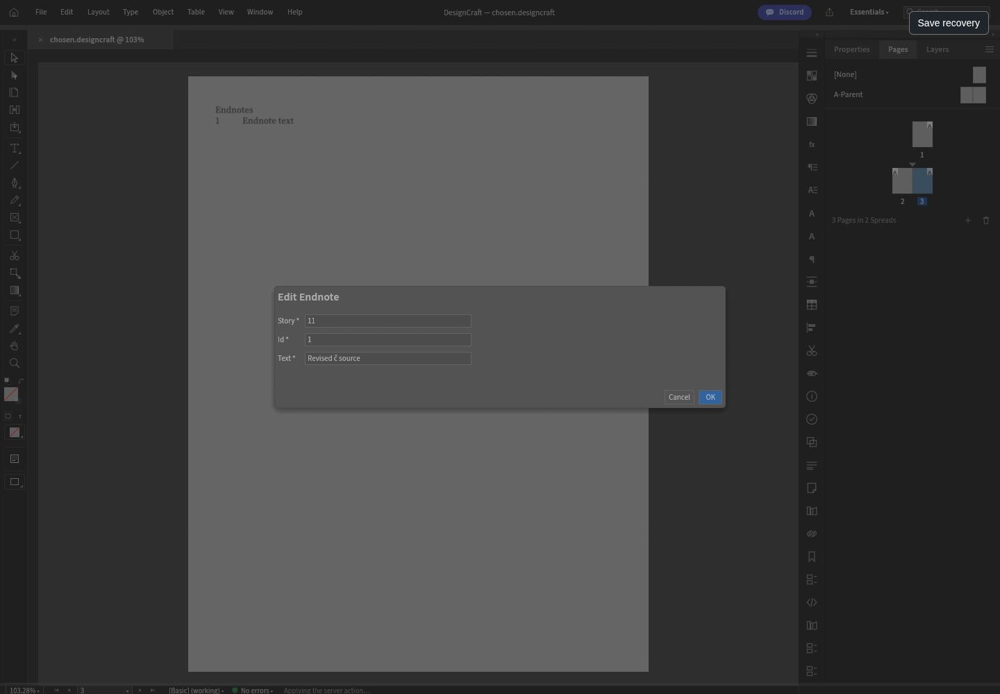
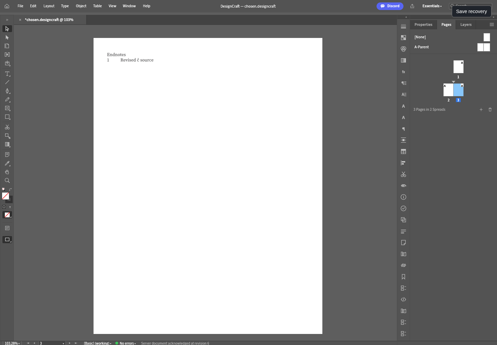

# Original DesignCraft Edit Endnote — alpha.75 candidate

The existing `endnote.edit` command is registered as **Edit Endnote**, without a static menu path. Upstream Quick Apply filters out menu-less commands. A bounded hosted search inclusion uses this original registry label/ID to open the existing generic story/id/text command form; the standalone filter and static menus stay unchanged. The browser caught the missing entry before acceptance; a real palette discovery test now covers document/pending gates. Original JSON parsing, whitespace trimming and omission of empty fields remain. Missing text retains the native command's original meaning: clear the note text, preserving its reference.

The owned gateway and native worker admit only positive wasm32 story/note IDs and optional text up to 4 KiB UTF-8. Native validation resolves the existing target, checks original document/numbering/listing budgets, checks the proposed listing, and executes the unchanged command on an isolated COW Session. Its exact document and canonical JSON must fit before the real Session or Undo history changes. Unknown target, malformed fields, excess UTF-8 and ID overflow are refused before mutation. Limits are a bounded prototype policy, not a claim of complete memory protection.

The original form keeps the draft while the command is pending or failed. Matching command/revision/document/selection ACK precedes hydration and closure. Enter, Escape, duplicate submission and underlying canvas typing cannot alter the document while pending. The original note text and generated listing change; the native parent-story revision advances once while body text/reference, other notes, pages and selection are preserved.

Validation: 20 native tests (14 malformed/unknown targets before mutation plus formatting-budget refusal; empty-text behavior; original listing; Undo/Redo and native save/reopen), 172 UI tests +1 existing ignored, 39 gateway tests. 97 repository tests, npm check, release metadata/YAML and actual original browser Cancel, injected pre-mutation422, retained retry draft, held ACK/duplicate Enter/Escape/typing guard, exact story/id/UTF-8 payload, Undo/Redo canonical+PNG and retained Save Copy/fresh reopen passed. Zero unexpected page/console/network errors; one expected422. The source laptop fixture bytes remain unchanged. [Native report](designcraft-endnote-edit-native.json) · [Browser report](designcraft-endnote-edit-browser.json).

Generated native documents only. Browser folder permissions are protocol fixtures, not real OS chooser acceptance. Retained server Save Copy and fresh native reopen are exercised; laptop write/provider parity remains open. Local worker/WASM are QA artifacts only. Exact-source Actions/tag/draft/downloaded asset verification is required. DesignCraft remains planned; full tools/providers/real OS/all13 server acceptance remains open.

## Measured artifacts and browser views

Source pin `a127c6d5c3576972bbd60445f26d893db071eef3`; reviewed cumulative source patch `19f8c75d3c3245a826794c2a9145ffa2a11b77719193848d55490f426cec04d3`. Local QA worker `3b691638fbe71a667b3989439dc577b2fa539f8a91e9e1fd3ea517898c5dce17`; local QA WASM `cdff8137dcc253a880f93d133596c4cf46b2f3dcf065a8e195d037eb0316b8af` (40350712 bytes). Actions artifacts must be measured independently; local identity is not assumed.

