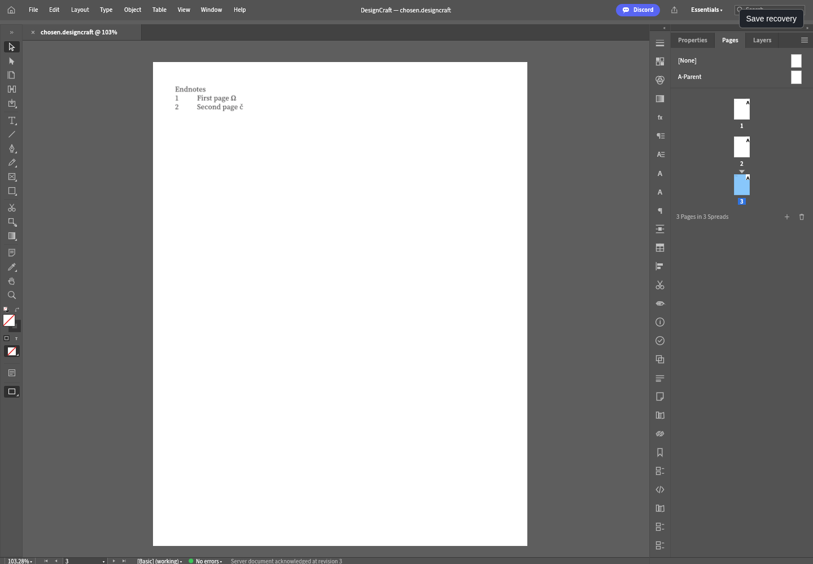

# DesignCraft alpha77 current-adapter CI fixture correction — 2026-10-26

[Build40318334340](https://github.com/vedranius/creative-workspace/actions/runs/40318334340) failed in original-designcraft for source85c64cb: the UI provenance patch embeds an older native adapter. Its22 tests passed, but it had no endnote.list fixture generator. The later browser smoke failed ENOENT. Checks40318334230 and23 build jobs succeeded; publish was skipped. The failed run is preserved without rerun/cancel. [Machine proof](designcraft-endnote-list-ci.json).

The workflow now calls verify-designcraft-native-contract.mjs. It checks the exact reviewed UI diff/patch digest, backs up its embedded adapter, stages the current engines/designcraft/native adapter used by the owned native installer, and runs locked native contract tests. All fixture output variables point to the same evidence directory. Required fixture files must be new and nonempty, and the original query/page-order report must verify. Existing outputs are refused before test execution. The prior adapter and exact reviewed UI source are restored in finally, including when Cargo fails. Successful provenance is written only after test/fixture/restoration success. UI patch/WASM and product worker remain unchanged.

A fresh pinned source clone plus the exact existing UI patch passed25 actual current-adapter tests and generated all eight required files. Injected Cargo exit23 propagated without a success report, restored the exact reviewed source and removed its temporary backup. Reusing prior fixture outputs was refused before tests. npm check,102 repository tests, release validation, YAML and privacy/diff checks pass. [Original-browser report using the freshly generated fixture](designcraft-endnote-list-ci-browser.json).

The fresh fixture opens in the actual original UI through the real gateway/owned worker. Native page-order notes and version3, held query, cached duplicate, invalid/stale rejection, unchanged canonical/selection/dirty/history/native PNG and original Edit Endnote form cancel pass. Zero unexpected browser errors; two expected400/409 responses. Both screenshots inspected. QA/helper/session/server closes and owned disk TMP link is removed. The existing worker/UI/WASM are reused; this verifies the CI input correction, not a new preview or UI feature.

This is a CI-only correction to the unpublished alpha77 candidate. Remote77 tag/release were absent; no published tag/release/assets are changed. No new product behavior/SemVer or full acceptance is claimed. Corrected exact-source Actions and immutable downloaded assets/checksums still must pass. Original endnote.list presentation/automatic targets, real OS/provider/full13 acceptance remain open; DesignCraft stays planned.

Next B in SAME MAIN from f58276484da3ce7536dac18ec0ddede646950668: one exact Checks40358723956/pixel40358723927 snapshot, then original Duplicate Preset for one existing Exposure Tool child within its folder. Follow docs/rapidraw-wasm-app-child-configure-handoff.md; separate default-off permission/pinned source patch, original fresh UUID/Copy name/same-folder insertion, durable commit/readback before publication; preserve parent/siblings/values/flags/order and prove held/abort/stale/uncertain reload/no replay/native clone application. Reuse existing stage/cache/WASM/lock, no native rebuild. Next A: one exact corrected alpha77 Checks/Build snapshot for the new commit below; after success verify new immutable77 tag/draft/exact source/24 downloaded Actions assets/12 sidecars/pins/independently measured Actions WASM. Preserve failed40318334340 without rerun/cancel. Alpha76..69 gates complete. Original endnote.list UI result presentation/automatic form targets and full tools/providers/real OS/all13 remain open; DesignCraft planned. SAME MAIN only, no create/fork/newwriter/security/main-B merge/private inputs/protected services/demo; preserve FilmCraft/originals/target.
